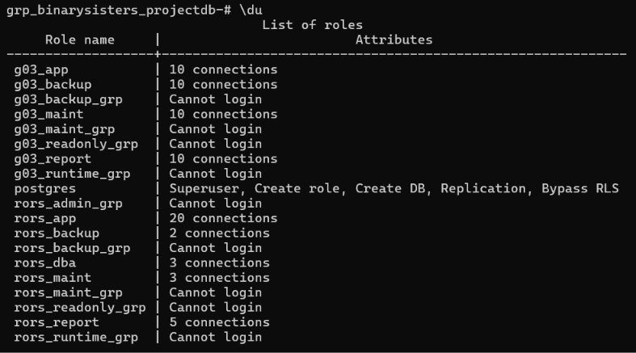
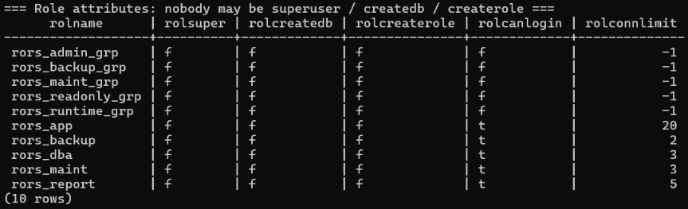
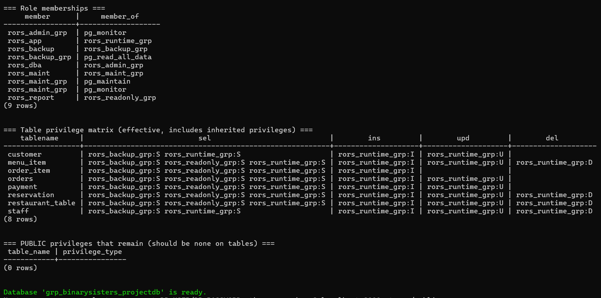
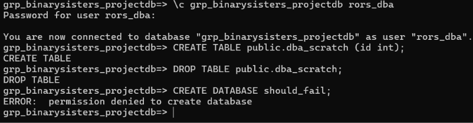
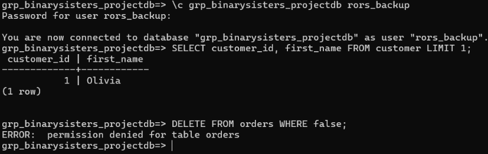
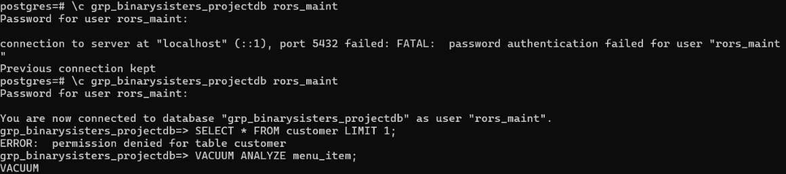
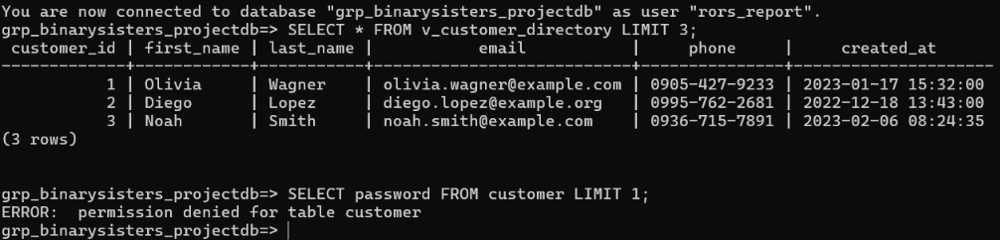
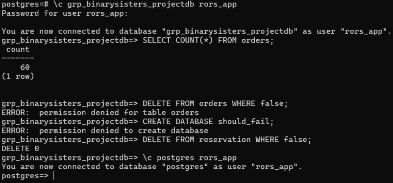
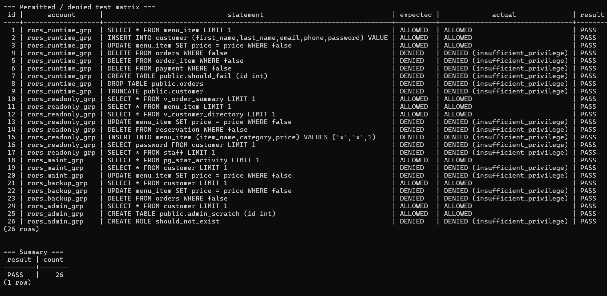

# Privilege Testing Results

## 1. Database roles & attributes verification 
The database environment was verified to ensure that all standard roles (`g03_*`, `rors_*`) are properly configured and unnecessary personal roles are cleaned up

### Role list (\du)

### Role attributes & connection limits

### Role memberships & table privilege matrix

---

## 2. Interactive role login & privilege enforcement tests
Manual connection and query tests were performed using `\c` to verify that each user account complies with its assigned permissions and restrictions[cite: 22].

### 2.1 Database administrator (rors_dba)
* **Test:** Can create/drop temporary tables, but restricted from creating new databases[cite: 22].

### 2.2 Backup role (rors_backup)
* **Test:** Can read table data (`SELECT`), but cannot modify or delete data[cite: 22].

### 2.3 Maintenance role (rors_maint)
* **Test:** Can perform maintenance tasks like `VACUUM`, but blocked from direct `SELECT` queries on restricted tables[cite: 22].

### 2.4 Reporting role (rors_report)
* **Test:** Can access reporting views, but restricted from reading sensitive columns (e.g., passwords)[cite: 22].

### 2.5 Application role (rors_app)
* **Test:** Full transactional access on allowed tables, blocked from restricted deletions and database creation[cite: 22].

---

## 3. Automated security verification matrix
Automated verification scripts (`04_verify_privileges.sql`) tested all permissions across operational roles.

* **Total tests executed:** 26
* **Passed:** 26[cite: 22]
* **Failed:** 0[cite: 22]

### Test Matrix Execution Logs

