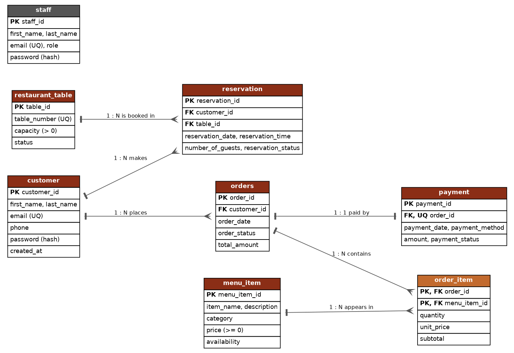
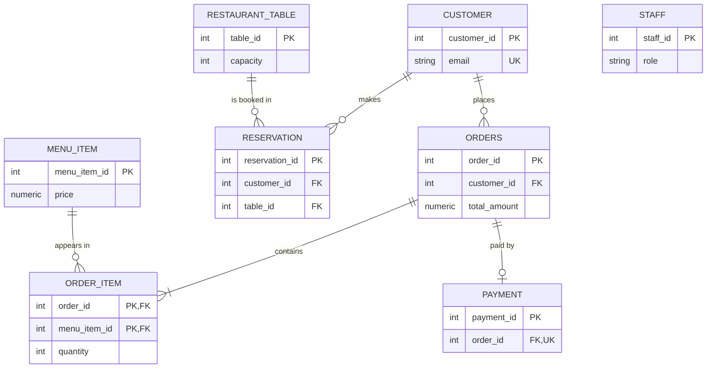

# Entity-relationship diagram

`staff` has no foreign key in the approved design (it holds the logins of people who manage the system).
`orders` ⟷ `menu_item` is the many-to-many relationship resolved by the associative table `order_item`.
