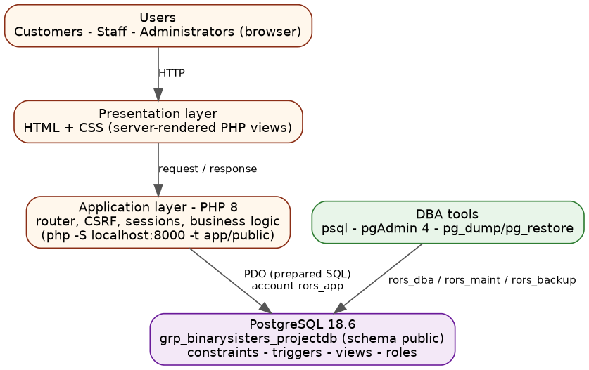
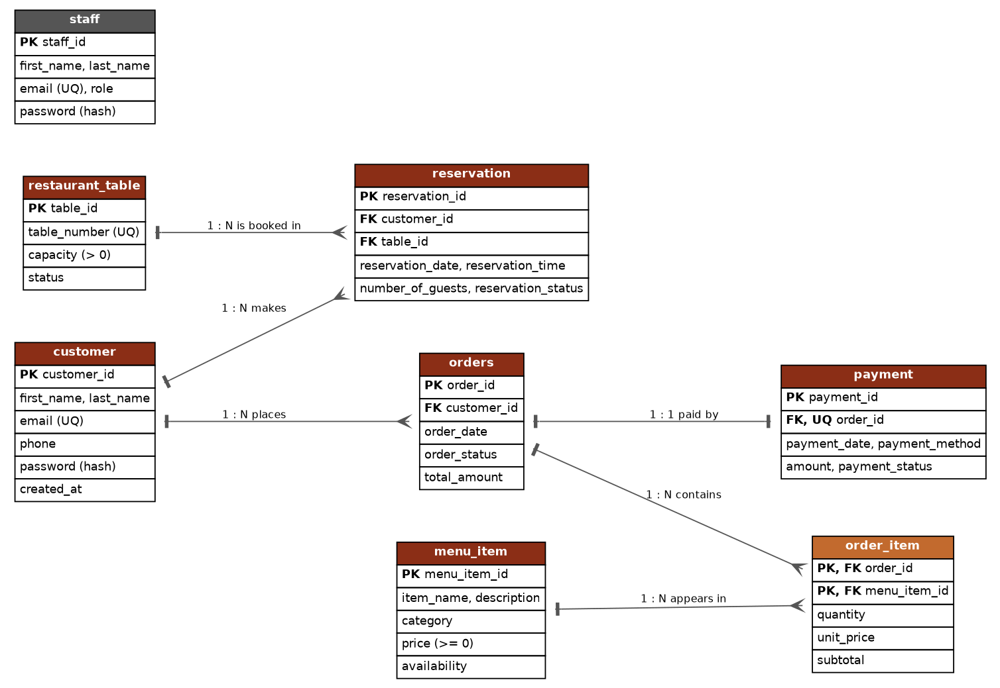

**COMP 018 - Database Administration** · Prof. John Kenneth Timblaco · Group **Binary Sisters** · Group no. \_\_ [TO COMPLETE]

> **How to use this document.** Everything that is design or code in the repository is already written here. Items marked
> **[TO COMPLETE]** need real evidence that only the group can produce (screenshots, dates, commit hashes, results of testing
> other groups' projects). Do not invent results. Delete these notes before submitting, and check every screenshot for passwords.

# 1. Cover and team

| Item | Value |
|---|---|
| Project title | Restaurant Online Ordering & Table Reservation System |
| Group | Binary Sisters (Group no. __ [TO COMPLETE]) |
| Repository URL (access type) | \<REPOSITORY_URL\> (public / private with all groups invited) [TO COMPLETE] |
| Class tracker link | \<TRACKER_URL\> [TO COMPLETE] |
| User roles document | docs/user-roles.md in the repository (link in tracker) [TO COMPLETE] |
| Approved design | Activity 2 - submitted 2026 September 26 |

| Member | Role in the project | Main contribution [TO COMPLETE] |
|---|---|---|
| Sandoval, Cellyn S. | [TO COMPLETE] | |
| Callos, Kathlen Mae L. | [TO COMPLETE] | |
| Romingquit, Arika E. | [TO COMPLETE] | |
| Tambio, Jenny Mae N. | [TO COMPLETE] | |
| Tungol, Jaimie N. | [TO COMPLETE] | |
| Gordonas, John Benedick | [TO COMPLETE] | |

# 2. System overview (Activity 3)

**Purpose.** Restaurants that take orders and reservations by phone, message or paper suffer wrong orders, double bookings and
slow status updates (Activity 2, Part 2). The system lets customers view the menu, order online, reserve a table and track both,
while staff manage the operation. **Scope** follows Activity 2: payroll, suppliers, accounting and inventory are excluded.

| # | Approved feature (Activity 2, Part 2B) | Where implemented |
|---|---|---|
| 1 | Customer registration and login | `/register`, `/login`, `/profile` |
| 2-3 | View menu, search and item details | `/menu`, `/menu/item` |
| 4-5 | Place orders with multiple items | `/cart`, `/checkout` (one transaction: orders + order_item + payment) |
| 6-7 | Make reservation, check availability | `/reservations/new` (availability query + database no-overlap constraint) |
| 8 | View order and reservation status | `/orders`, `/reservations` |
| 9-10 | Manage menu items and tables | `/admin/menu`, `/admin/tables` |
| 11 | Manage customer orders | `/admin/orders` |
| 12 | Record and manage payments | `/admin/payments` |

Architecture (unchanged from Activity 2): Users → HTML/CSS → PHP 8 application → PostgreSQL 18.6 via PDO.

{width=75%}

# 3. User roles

Full text: `docs/user-roles.md` and `docs/user-role-setup.md`.

| Application role | Functions and data access | Database role / account |
|---|---|---|
| Customer | register, edit own profile, order, reserve, view/cancel own pending orders and reservations | via application runtime `rors_app` ∈ `rors_runtime_grp` |
| Staff | read operations; update order, reservation, payment status; record payments; toggle menu availability | via `rors_app` (restrictions enforced in the application) |
| Administrator | staff functions + create/edit/delete menu items and tables, delete reservations, customers list, staff accounts | via `rors_app`; DBA tasks use a separate account |
| Application runtime | only the DML the code needs; no DDL, no DELETE on orders/payments/order lines | `rors_app` ∈ `rors_runtime_grp` |
| Viewer / auditor | read-only on approved tables and views; no access to password hashes | `rors_report` ∈ `rors_readonly_grp` |
| DBA - maintenance | VACUUM/ANALYZE, monitoring | `rors_maint` ∈ `rors_maint_grp` (`pg_maintain`, `pg_monitor`) |
| DBA - backup | pg_dump | `rors_backup` ∈ `rors_backup_grp` (`pg_read_all_data`) |
| DBA - administrator | day-to-day administration, not a superuser | `rors_dba` ∈ `rors_admin_grp` |

# 4. Development progress log

| Date | Milestone / work done | Who | Key commits |
|---|---|---|---|
| 2026-09-26 | Activity 2 design submitted: requirements, 12 business rules, ERD, schema, architecture | all | - |
| [date] | Repository created, members added as collaborators | [name] | [hash] |
| [date] | Migrations 001-004 created and run on PostgreSQL 18.6 | [name] | [hash] |
| [date] | Seed data loaded | [name] | [hash] |
| [date] | PHP application: authentication and menu | [name] | [hash] |
| [date] | Orders, cart, checkout transaction | [name] | [hash] |
| [date] | Reservations and availability | [name] | [hash] |
| [date] | Staff/admin pages | [name] | [hash] |
| [date] | Roles and privileges (database/roles) | [name] | [hash] |
| [date] | Documentation, tracker registration, cross-group testing | all | [hash] |

[TO COMPLETE - dates, names and commit hashes must come from `git log --oneline --author=...`; every member should appear.]

# 5. Database implementation

{width=100%}

| Item | Value |
|---|---|
| Database / schema / version / owner | grp_binarysisters_projectdb / public / PostgreSQL 18.6 / postgres |
| Tables (8) | customer, menu_item, restaurant_table, staff, orders, order_item, reservation, payment |
| Scripts | `database/migrations/000-004`, `database/seeds/001_seed_data.sql`, `database/roles/01-04`, `database/setup.ps1` |
| Seed volume | 2 staff, 5 customers, 10 menu items, 8 tables, 6 orders (14 lines), 5 payments, 7 reservations |
| Extra database logic | deferred triggers (order needs ≥ 1 item), total trigger, capacity trigger, exclusion constraint (no double booking), 4 views, 6 indexes |

**Changes from the approved Activity 2 design** (details in `docs/changes-from-activity2.md`)

| Change | Reason |
|---|---|
| Singular names `menu_item`, `order_item` | Activity 2 mixed singular/plural; the pgAdmin-generated ERD used singular |
| `price >= 0` and no `UNIQUE(item_name)` | Part 6 schema is authoritative; the Part 11 sample differed |
| CHECK constraints on status/role/method columns | prevent typos that break the application |
| Order total and subtotal consistency (trigger + CHECK) | the total must always match the lines |
| BR9 "order has at least one item" via deferred trigger | cannot be expressed as a column constraint |
| Exclusion constraint and capacity trigger | the problem statement names double bookings |
| Views and indexes added | planned "other objects" in Activity 2; needed for read-only access (Activity 4) |

# 6. Application evidence (Activity 3)

Database-level test: `tests/crud_tests.sql` (runs inside a transaction that is rolled back).

| Operation | Test | Expected | Actual [TO COMPLETE] | Screenshot |
|---|---|---|---|---|
| Create | register a customer; place an order with 2 items; reserve a table | rows created; order total = sum of lines | | [Figure] |
| Retrieve | menu search "adobo"; "My orders"; admin order list | correct rows only | | [Figure] |
| Update | staff sets order *confirmed*; admin edits a menu price | status/price changed; old order lines keep old price | | [Figure] |
| Delete | admin deletes an unused menu item; deletes an item used in orders | first succeeds; second refused (foreign key) | | [Figure] |
| Rules | book same table twice; 5 guests at a 2-seat table; negative price | all rejected | | [Figure] |

**[SCREENSHOT REQUIRED]** home/menu page · cart and order confirmation · reservation availability page · admin dashboard · `crud_tests.sql` output (all PASS).

# 7. Setup and configuration

1. `git clone \<REPOSITORY_URL\>`; PostgreSQL 18 + PHP 8.1+ (`pdo_pgsql`) + `psql` on PATH.
2. `.\database\setup.ps1 -WithRoles` (hidden password prompts; nothing stored).
3. `copy .env.example .env` → set `DB_USER=rors_app` and its password locally.
4. `php -S localhost:8000 -t app/public`.

| Environment variable | Placeholder value |
|---|---|
| DB_HOST / DB_PORT / DB_NAME | localhost / 5432 / grp_binarysisters_projectdb |
| DB_USER / DB_PASSWORD | rors_app / CHANGE_ME |
| APP_DEBUG / APP_TIMEZONE / DB_SSLMODE | false / Asia/Manila / prefer |

Database users and roles: see section 3 and `docs/user-role-setup.md`.

# 8. Issues and resolutions

| # | Problem met | Cause | How it was solved | Who |
|---|---|---|---|---|
| 1 | [TO COMPLETE - real problems only] | | | |

*Known design-level issues found while implementing the Activity 2 design are listed in section 5 (changes).*

# 9. Cross-group verification (Activity 3 Part D)

| Project tested (group, repo) | Setup result | Roles exercised | Issues found | Feedback sent |
|---|---|---|---|---|
| Group __ - [TO COMPLETE] | | | | |

Feedback received on our project and fixes made: [TO COMPLETE]

# 10. Activity 4 - Database users, roles, privileges and access control

## 10.1 Projects set up

| Group / project | Repository @ branch | Database | Objects (tables / views / sequences) | Setup result |
|---|---|---|---|---|
| Group __ | [TO COMPLETE] | | | |

## 10.2 Access-control plan

Reference plan, already implemented for our own project (`database/roles/`), which the group used as a model:

| Login | Group role | Application role served | Responsibility | Privileges |
|---|---|---|---|---|
| rors_app | rors_runtime_grp | Application runtime | normal operations | S/I/U on customer, orders, payment; S/I/U/D on menu_item, restaurant_table, reservation, staff; S/I on order_item; sequences |
| rors_report | rors_readonly_grp | Viewer / auditor | reports | SELECT on non-credential tables and 4 views |
| rors_maint | rors_maint_grp | DBA - maintenance | VACUUM, ANALYZE, monitoring | pg_maintain, pg_monitor |
| rors_backup | rors_backup_grp | DBA - backup | pg_dump | pg_read_all_data |
| rors_dba | rors_admin_grp | DBA - administrator | administration | ALL on public tables/sequences, CREATE on schema |

Per other project: one table like this in `db-access-control/group-XX/access-control-plan.md` [TO COMPLETE - copy the key rows here].

## 10.3 SQL scripts summary
`db-access-control/_template/00-05*.sql` (inventory, roles and grants, passwords by prompt, tuning, test matrix, privilege review) and `run-activity4.ps1`. Roles are prefixed per project (`g03_...`) because roles are cluster-wide. Folder link: [TO COMPLETE].

## 10.4 Verification results

| Project | Account | Statement | Expected | Actual | Evidence |
|---|---|---|---|---|---|
| Group __ | g__app | SELECT on authorised table | Allowed | [TO COMPLETE] | |
| Group __ | g__report | UPDATE | Denied | | |
| Group __ | g__app | CREATE DATABASE | Denied | | |
| Group __ | g__app | connect to an unrelated database | Denied | | |

Reference result on our own database (`04_verify_privileges.sql`): [TO COMPLETE - paste PASS/FAIL summary].

## 10.5 Issues and fixes · 10.6 Feedback to owners

| Project | Unexpected result | Cause | Fix / feedback sent (date) |
|---|---|---|---|
| Group __ | [TO COMPLETE] | | |

# 11. Activity 5 - Database maintenance and monitoring

## 11.1 Projects monitored

| Project | Repository | Database | Accounts and application roles used |
|---|---|---|---|
| Group __ | [TO COMPLETE] | | g__maint (DBA-maintenance), g__report (viewer) |

## 11.2 Health and activity evidence · 11.3 Log findings

Per project: output of `01_health_checks.sql` with interpretation, and `log-findings.md` (evidence, explanation, impact, next step; or what was checked if nothing was found). [TO COMPLETE]

## 11.4 Maintenance performed

| Project | Command | Why chosen | Account / date | Result |
|---|---|---|---|---|
| Group __ | `ANALYZE;` and `VACUUM (VERBOSE, ANALYZE) public.<table>;` | refresh planner statistics; reclaim dead tuples; no VACUUM FULL (exclusive lock) | g__maint | [TO COMPLETE] |

## 11.5 Query performance

| Project | Query (application role) | Scan type | Est. vs actual rows / time | Recommendation |
|---|---|---|---|---|
| Group __ | [TO COMPLETE] | | | |

## 11.6 Recommendations, limitations, feedback

| Project | Priority | Recommendation | Limitation (permissions/logging) | Feedback sent |
|---|---|---|---|---|
| Group __ | Immediate / Follow-up / None | [TO COMPLETE] | | |

# 12. Activity 6 - Backup, restoration and recovery

## 12.1 Projects covered and backup plan

| Project | Database | Account | Method | Storage | Schedule / retention | RPO / RTO |
|---|---|---|---|---|---|---|
| Group __ | [TO COMPLETE] | g__backup | pg_dump -Fc | protected folder outside the repository | nightly / 7 daily, 4 weekly, 3 monthly | e.g. 24 h / 2 h |

Roles after restore: `pg_dump` of one database does not contain cluster-wide roles or the database-level CONNECT grant, so the Activity 4 script is re-run for the restored database and one permitted and one denied operation are tested.

## 12.2 Backup creation and inspection

| Project | File name | Size | SHA-256 | Date/time | `pg_restore --list` evidence |
|---|---|---|---|---|---|
| Group __ | [TO COMPLETE - from evidence/backup-log.csv] | | | | |

## 12.3 Restoration and verification · 12.4 Access control after restore

| Project | Restore database | Objects | Row counts equal | Constraints present | Access control re-created and tested | Result |
|---|---|---|---|---|---|---|
| Group __ | `<db>_restore_test` | [TO COMPLETE] | | | | |

## 12.5 Recovery simulation

| Project | Incident (disposable row) | Timeline | Method | Recovered? |
|---|---|---|---|---|
| Group __ | [TO COMPLETE] | | fresh restore into `<db>_recovery`, copy the row back | |

Loss after the newest backup would be unrecoverable from that file - this is what the RPO expresses.

## 12.6 Evaluation, limitations and errors, feedback

Is nightly `pg_dump` enough for a restaurant system? [TO COMPLETE - discuss RPO/RTO measured vs proposed; WAL archiving/PITR, off-site copies, restore drills]

# 13. AI usage declaration

| AI tool | Tasks performed | How the group validated or corrected the output |
|---|---|---|
| Claude | Generated the application code, SQL scripts, role scripts, Activity 4-6 templates and the documentation skeleton from the approved Activity 2 design | [TO COMPLETE - what was run, what failed, what was changed] |
| ChatGPT / Gemini | [TO COMPLETE if used] | |

Members must be able to explain the triggers, the exclusion constraint, the GRANT/REVOKE structure and the backup/restore commands.
No real passwords, API keys or secrets appear in this document.
